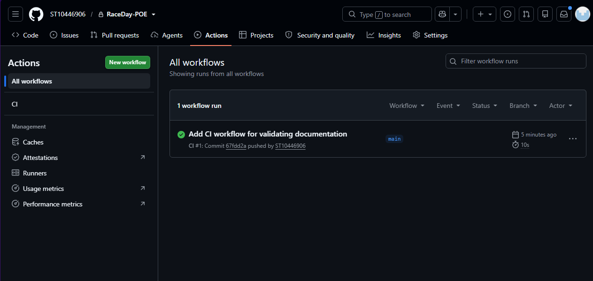

# RaceDay – Event Management System

[](https://github.com/Lindo6906/RaceDay-POE/actions/workflows/part2-ci.yml)

RaceDay is a full-stack, web-based event management system for the South African road running, walking and cycling community. Event Organisers create and manage events, categories and results. Participants browse events, enter them, and track their own performance history.

## Contents

- [System overview](#system-overview)
- [Repository structure](#repository-structure)
- **[Part 1 – System Planning and Database](#part-1--system-planning-and-database)**
  - [ERD design decisions](#erd-design-decisions) · [API endpoint plan](#api-endpoint-plan) · [Database schema](#database-schema) · [Sample data](#sample-data) · [Database setup](#database-setup) · [CI/CD](#part-1-cicd) · [Notes and troubleshooting](#part-1-notes-and-troubleshooting)
- **[Part 2 – RESTful API](#part-2--restful-api)**
  - [Technology](#part-2-technology) · [Roles](#roles) · [Setup and run](#setup-and-run) · [Using Swagger](#using-swagger) · [Unit tests](#unit-tests) · [Design decisions](#part-2-design-decisions) · [Endpoints](#endpoints) · [Database](#part-2-database) · [Differences from Part 1](#differences-from-the-part-1-plan) · [CI/CD](#part-2-cicd) · [Video](#video-walkthrough)
- [Version history](#version-history)

---

## System overview

### For Organisers
- **Event management:** create, edit and delete running, walking and cycling events
- **Category management:** define race categories (5km, 10km, 21km, 42km, etc.)
- **Participant tracking:** view all enrolments for their events
- **Results capture:** record finish times and positions

### For Participants
- **Registration:** create an account with role selection
- **Event discovery:** browse and search upcoming events
- **Event entry:** enrol in an event by selecting a category
- **Performance history:** view personal results across all events

### Architecture
Multi-tier: **Database → API → Client**, with a normalised SQL Server schema and role-based access control.

## Repository structure

```
RaceDay-POE/
├── .github/workflows/
│   ├── (Part 1 documentation validation workflow)
│   └── part2-ci.yml                 # Part 2 build + test
├── docs/
│   ├── ERD.png                      # Part 1
│   ├── API-Endpoint-Plan.md         # Part 1
│   ├── RaceDay_Database.sql         # Part 1
│   └── CI-Part2-Green-Build.png     # Part 2
├── Part2-API/
│   ├── RaceDay.sln
│   ├── RaceDay.Api/                 # Web API (Models, Data, Dtos, Security, Controllers)
│   ├── RaceDay.Api.Tests/           # xUnit tests
│   └── Database/                    # SQL scripts for the Part 2 schema
├── CI-CD-Green-Build.png            # Part 1
└── README.md
```

---

# Part 1 – System Planning and Database

Part 1 covers the planning and database design for RaceDay: the ERD, the API endpoint plan, the SQL script with sample data, and a CI workflow that validates the documentation.

## ERD design decisions

**File:** `/docs/ERD.png`

| Decision | Reasoning |
|----------|-----------|
| **Single `Users` table** with a `Role` field (Organiser / Participant) | Simplifies authentication and avoids duplication while keeping the roles clearly separated. |
| **`EventCategories` junction table** | Supports a many-to-many relationship between Events and Categories, so an event can offer several categories and a category can be reused across events. |
| **Separate `Enrolments` and `Results`** | Participants can enrol before results exist, results can be updated without touching the enrolment, and both registration and performance are tracked historically. |

## API endpoint plan

**File:** `/docs/API-Endpoint-Plan.md`

| Category | Description | Endpoints |
|----------|-------------|-----------|
| Authentication | User registration and login | 2 |
| User Management | Profile management | 3 |
| Event Management | CRUD operations | 5 |
| Category Management | CRUD operations | 5 |
| Event Categories | Junction management | 2 |
| Enrolments | Registration management | 6 |
| Results | Performance tracking | 6 |
| **Total** | **Complete RESTful API** | **29** |

## Database schema

| Table | Purpose | Key fields |
|-------|---------|------------|
| Users | Stores all user accounts | UserID, Email, Role |
| Events | Event information | EventID, OrganiserID, EventDate |
| Categories | Race distance categories | CategoryID, CategoryName |
| EventCategories | Links events to categories | EventCategoryID, EventID, CategoryID |
| Enrolments | Participant registrations | EnrolmentID, ParticipantID, EventCategoryID |
| Results | Performance results | ResultID, EnrolmentID, FinishTime |

**Key relationships**
- One Organiser → many Events (1:M)
- Many Events ↔ many Categories (M:M via EventCategories)
- One EventCategory → many Enrolments (1:M)
- One Enrolment → one Result (1:1)

## Sample data

The SQL script seeds realistic test data so the system can be tested immediately:

| Type | Data |
|------|------|
| **Organisers** | John Smith, Sarah Johnson |
| **Participants** | Thabo Mokoena (registered for multiple events), Linda Botha |
| **Events** | Cape Town Cycle Tour (35,000 capacity), Soweto Marathon (30,000), Durban Summer Run (10,000) |
| **Categories** | 5km, 10km, 21km, 42km, 100km |

## Database setup

**Prerequisites:** SQL Server (Express, Developer or Enterprise), SQL Server Management Studio (SSMS), and a GitHub account for cloning.

1. Clone the repository:
   ```bash
   git clone https://github.com/Lindo6906/RaceDay-POE.git
   cd RaceDay-POE
   ```
2. Review the documentation in the `/docs` folder.
3. Open `docs/RaceDay_Database.sql` in SSMS and run it to create the database, tables and sample data.
4. Use the API endpoint plan as the guide for development.

## Part 1 CI/CD

A GitHub Actions workflow validates that the repository contains:
- the `/docs` folder
- the ERD file (PNG or PDF)
- the API endpoint plan (MD or PDF)
- the SQL script
- the required tables inside the SQL script

**Green build screenshot:** `CI-CD-Green-Build.png`



## Part 1 notes and troubleshooting

### Design decisions
1. **Single Users table:** a Role field is used instead of separate Organiser and Participant tables.
2. **Unique constraints:**
   - Email is unique in `Users`
   - Event + Category is unique in `EventCategories`
   - Participant + EventCategory is unique in `Enrolments`
3. **Cascading deletes:** deleting an Event or Category automatically removes its related `EventCategories` rows.
4. **Status flow:**
   - Enrolments: Registered → Cancelled / Completed
   - Results: Pending → Completed / Disqualified

### Future enhancements
- Payment processing
- Live weather and route information
- Participant analytics
- Automated notifications
- Mobile application

### Troubleshooting

**SQL script fails with "database in use".** Close the existing connections before dropping the database:

```sql
ALTER DATABASE RaceDayDB SET SINGLE_USER WITH ROLLBACK IMMEDIATE;
DROP DATABASE RaceDayDB;
```

---

# Part 2 – RESTful API

Part 2 turns the Part 1 design into a working RESTful API with authentication, role-based access, documentation and automated tests.

## Part 2 technology

| Area | Choice |
|------|--------|
| Framework | ASP.NET Core 8 Web API (C#) |
| Data access | Entity Framework Core 8, Code-First, SQL Server |
| Authentication | Session (cookie) based, passwords hashed with PBKDF2 |
| API documentation | Swagger / OpenAPI (Swashbuckle) |
| Testing | xUnit with `WebApplicationFactory` and the EF Core in-memory provider |
| CI/CD | GitHub Actions (`.github/workflows/part2-ci.yml`) |

## Roles

| Role | Permissions |
|------|-------------|
| **Organiser** | Create, edit and delete **their own** events; define categories for them; view all enrolments for their events; capture and correct finish times and positions. |
| **Participant** | Browse events and categories; enter an event by choosing a category; view or withdraw their own enrolments; view their own results. |

Both roles can register, log in, log out, and view or update their own profile.

## Setup and run

### Prerequisites
- [.NET 8 SDK](https://dotnet.microsoft.com/download/dotnet/8.0)
- SQL Server or SQL Server LocalDB (installed with Visual Studio)
- Visual Studio 2022 (ASP.NET workload) or the `dotnet` CLI

### 1. Clone and open
```bash
git clone https://github.com/Lindo6906/RaceDay-POE.git
cd RaceDay-POE/Part2-API
```
Open `RaceDay.sln` in Visual Studio, or work from the command line.

### 2. Configure the connection string
Edit `RaceDay.Api/appsettings.json`:
```json
"ConnectionStrings": {
  "DefaultConnection": "Server=(localdb)\\MSSQLLocalDB;Database=RaceDayDb;Trusted_Connection=True;TrustServerCertificate=True"
}
```

### 3. Create the database (choose **one** option)

**Option A – EF Core migrations (recommended, Code-First)**
```bash
dotnet tool install --global dotnet-ef      # once
dotnet ef migrations add InitialCreate --project RaceDay.Api
dotnet ef database update --project RaceDay.Api
```
In Visual Studio, use the Package Manager Console instead: `Add-Migration InitialCreate`, then `Update-Database`.

**Option B – SQL script**
Run `Part2-API/Database/01_RaceDay_Schema.sql` in SSMS. Do not combine this with migrations.

The `Roles` table is seeded with **Organiser (1)** and **Participant (2)**. Optionally run `02_RaceDay_SampleData.sql` after registering an Organiser, and use `03_RaceDay_Verify.sql` to check the data.

### 4. Run the API
```bash
dotnet run --project RaceDay.Api
```
or press **F5** in Visual Studio. Swagger opens at `/swagger`.

## Using Swagger

Authentication is cookie based, so no token is needed.

1. `POST /api/auth/register` – register as a **Participant**, or as an **Organiser** by including `organiserCode` (set in `appsettings.json` under `Registration:OrganiserCode`, default `RACEDAY-ORG-2026`).
2. `POST /api/auth/login` – the browser stores the session cookie.
3. Call any other endpoint from the Swagger page. `POST /api/auth/logout` ends the session.

**Status codes used:** `200` OK · `201` Created · `204` No Content · `400` Validation error · `401` Not logged in · `403` Wrong role or not the owner · `404` Not found · `409` Conflict (duplicate or rule violation).

## Unit tests

```bash
dotnet test RaceDay.sln
```
The tests start the real API in memory with the EF Core in-memory provider, so no SQL Server is required. They cover:

| Test file | Covers |
|-----------|--------|
| `AuthTests.cs` | Registration, duplicate email, organiser code, login, logout, profile |
| `EventTests.cs` | Event and category CRUD, role checks, ownership checks |
| `EnrolmentTests.cs` | Enrolling, duplicate and invalid enrolments, withdrawing, organiser views |
| `ResultTests.cs` | Capturing results, role and ownership checks, participant results |

## Part 2 design decisions

| Topic | Decision |
|-------|----------|
| **Role selection** | The user picks a role at registration, but registering as an Organiser requires a secret code so anyone cannot make themselves an Organiser. |
| **Passwords** | Hashed with PBKDF2-HMAC-SHA256 (100,000 iterations, random 16-byte salt). Plain text is never stored or returned. |
| **Sessions** | `UserId` and `Role` live in the server-side ASP.NET Core session. A `[SessionAuthorize]` filter returns **401** when not logged in and **403** for the wrong role. |
| **Ownership** | An Organiser can only modify, or view enrolments and results of, events they created. |
| **Data rules** | One enrolment per participant per event; the category must belong to the event; one result per enrolment; finishing positions are unique within an event. |

## Endpoints

| Method | Route | Access | Purpose |
|--------|-------|--------|---------|
| POST | `/api/auth/register` | Public | Create an account |
| POST | `/api/auth/login` | Public | Start a session |
| POST | `/api/auth/logout` | Public | End the session |
| GET | `/api/profile` | Any role | View own profile |
| PUT | `/api/profile` | Any role | Update own profile |
| GET | `/api/events?type=` | Any role | List events (filter Run / Walk / Cycle) |
| GET | `/api/events/{id}` | Any role | Get one event |
| POST | `/api/events` | Organiser | Create an event |
| PUT | `/api/events/{id}` | Organiser (owner) | Update an event |
| DELETE | `/api/events/{id}` | Organiser (owner) | Delete an event |
| GET | `/api/events/{eventId}/categories` | Any role | List an event's categories |
| POST | `/api/events/{eventId}/categories` | Organiser (owner) | Add a category |
| PUT | `/api/categories/{id}` | Organiser (owner) | Update a category |
| DELETE | `/api/categories/{id}` | Organiser (owner) | Delete a category |
| POST | `/api/events/{eventId}/enrolments` | Participant | Enter an event with a category |
| GET | `/api/enrolments/my` | Participant | View own enrolments |
| DELETE | `/api/enrolments/{id}` | Participant (owner) | Withdraw |
| GET | `/api/events/{eventId}/enrolments` | Organiser (owner) | Enrolments for one event |
| GET | `/api/enrolments` | Organiser | Enrolments across own events |
| POST | `/api/enrolments/{enrolmentId}/result` | Organiser (owner) | Capture finish time and position |
| PUT | `/api/results/{id}` | Organiser (owner) | Correct a result |
| GET | `/api/events/{eventId}/results` | Organiser (owner) | Results for one event |
| GET | `/api/results/my` | Participant | View own results |

## Part 2 database

The Part 2 schema follows the Part 1 ERD (`Roles`, `Users`, `Events`, `Categories`, `Enrolments`, `Results`).

| Table | Key fields |
|-------|------------|
| Roles | RoleId (1 Organiser, 2 Participant), RoleName |
| Users | UserId, RoleId, FullName, Email (unique), PasswordHash, PhoneNumber, CreatedAt |
| Events | EventId, OrganiserId, Name, Description, EventDate, Location, DistanceKm, EventType, CreatedAt |
| Categories | CategoryId, EventId, CategoryName |
| Enrolments | EnrolmentId, ParticipantId, CategoryId, EnrolmentDate, Status (unique: ParticipantId + CategoryId) |
| Results | ResultId, EnrolmentId (unique), FinishTime, Position, Status, RecordedAt |

## Differences from the Part 1 plan

| Area | Part 1 | Part 2 | Reason |
|------|--------|--------|--------|
| Events | No distance or type | Added `DistanceKm` and `EventType` (Run / Walk / Cycle) | Required by the Part 2 brief |
| Users | `Role` text field, `FirstName` / `LastName` in the SQL script | `Roles` table and `FullName`, as in the ERD | The Part 1 ERD and SQL script disagreed; the API follows the ERD |
| Categories | Global list linked through `EventCategories` | Each category belongs to one event | Matches the ERD and lets an Organiser define categories per event |
| Enrolments | Linked to `EventCategoryID` | Linked to `CategoryId`; event is reached through the category | Follows from the change above |
| Enrolment rule | Unique participant + category | Also one enrolment per event, enforced in code | A participant cannot enter two categories of the same race |
| Logout | Not planned | `POST /api/auth/logout` added | Needed to end a session |
| Event Categories endpoints | 2 junction endpoints | Not implemented | The junction table no longer exists in the Part 2 model |
| Passwords | Placeholder hashes in the sample data | Real PBKDF2 hashes | Sample users cannot log in; register through the API |
| Total endpoints | 29 planned | 23 implemented | See the changes above |

## Part 2 CI/CD

The workflow `.github/workflows/part2-ci.yml` restores, builds and tests the solution on every push.

**Green build screenshot:**


## Video walkthrough

[Watch the Part 2 walkthrough on YouTube](PASTE-YOUTUBE-LINK-HERE)

---

## Version history

| Part | Status | Scope |
|------|--------|-------|
| **Part 1 – System Planning** |  Complete | ERD with 6 entities, 29-endpoint plan, SQL script with sample data, documentation CI workflow |
| **Part 2 – API Development** |  Complete | C# RESTful API, SQL Server via EF Core, role-based access, Swagger, unit tests, CI |
| **Part 3 – MVC Application** |  Upcoming | MVC web app, Azure Blob Storage, Docker |

### Completed milestones

| Date | Milestone | Status |
|------|-----------|--------|
| 2026-08-04 | Repository created |
| 2026-09-01 | Part 1 CI/CD configured | 
| 2026-09-02 | ERD designed |
| 2026-09-02 | API endpoints planned | 
| 2026-09-02 | Database script written | 
| 2026-09-04 | Part 1 documentation complete | 
| 2026-10-12 | Part 2 API, tests and CI complete | 
