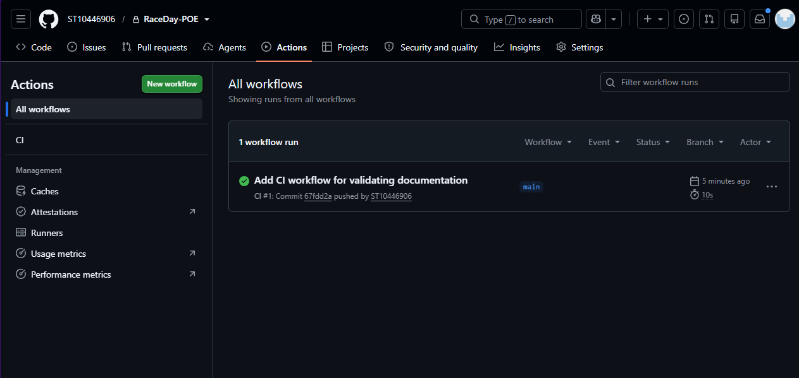
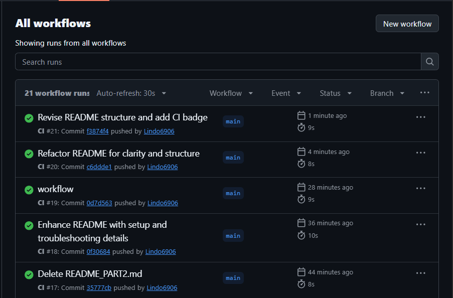
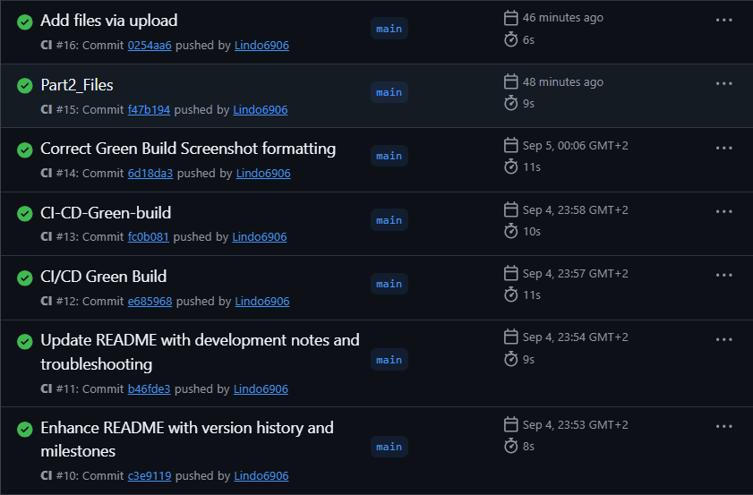
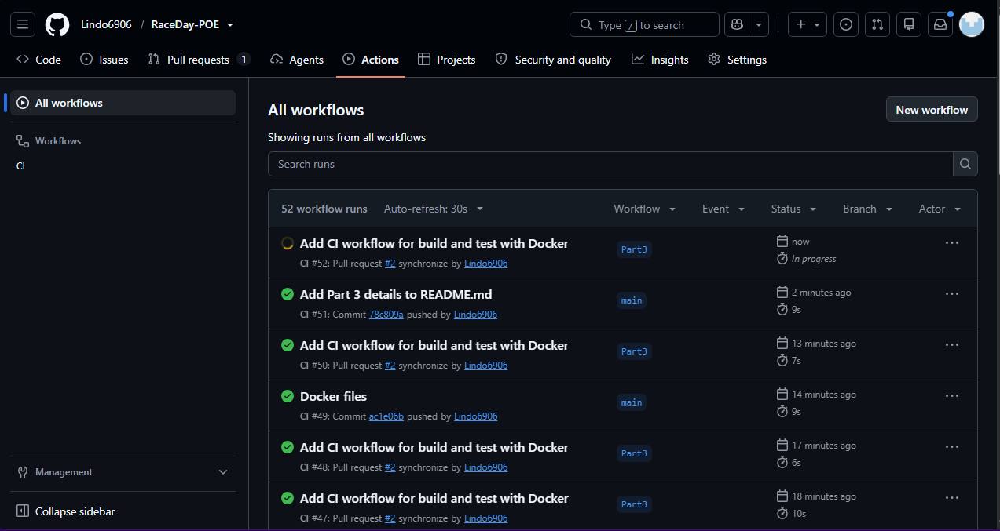

# RaceDay – Event Management System

[](https://github.com/Lindo6906/RaceDay-POE/actions/workflows/part2-ci.yml)
[](https://github.com/Lindo6906/RaceDay-POE/actions/workflows/part3-ci.yml)

RaceDay is a full-stack, web-based event management system for the South African road running, walking and cycling community. Event Organisers create and manage events, categories and results. Participants browse events, enter them, and track their own performance history.

## Contents

- [System overview](#system-overview)
- [Repository structure](#repository-structure)
- **[Part 1 – System Planning and Database](#part-1--system-planning-and-database)**
  - [ERD design decisions](#erd-design-decisions) · [API endpoint plan](#api-endpoint-plan) · [Database schema](#database-schema) · [Sample data](#sample-data) · [Database setup](#database-setup) · [CI/CD](#part-1-cicd) · [Notes and troubleshooting](#part-1-notes-and-troubleshooting)
- **[Part 2 – RESTful API](#part-2--restful-api)**
  - [Technology](#part-2-technology) · [Roles](#roles) · [Setup and run](#setup-and-run) · [Using Swagger](#using-swagger) · [Unit tests](#unit-tests) · [Design decisions](#part-2-design-decisions) · [Endpoints](#endpoints) · [Database](#part-2-database) · [Differences from Part 1](#differences-from-the-part-1-plan) · [CI/CD](#part-2-cicd) · [Video](#video-walkthrough)
- **[Part 3 – MVC Web Application](#part-3--mvc-web-application)**
  - [Technology](#part-3-technology) · [Project structure](#part-3-project-structure) · [Addresses](#part-3-addresses) · [Setup and run (Visual Studio)](#part-3-setup-and-run-visual-studio) · [Run with Docker](#part-3-run-with-docker) · [How the MVC app talks to the API](#part-3-how-the-mvc-app-talks-to-the-api) · [Screens](#part-3-screens) · [Design decisions](#part-3-design-decisions) · [CI/CD](#part-3-cicd) · [Video](#part-3-video) · [Notes and troubleshooting](#part-3-notes-and-troubleshooting)
- [Version history](#version-history)

---

## System overview

### For Organisers
- **Event management:** create, edit and delete running, walking and cycling events
- **Category management:** define race categories (5km, 10km, 21km, 42km, etc.)
- **Participant tracking:** view all enrolments for their events
- **Results capture:** record finish times and positions

### For Participants
- **Registration:** create an account with role selection
- **Event discovery:** browse and search upcoming events
- **Event entry:** enrol in an event by selecting a category
- **Performance history:** view personal results across all events

### Architecture
Multi-tier: **Database → API → Client**, with a normalised SQL Server schema and role-based access control.

## Repository structure

```
RaceDay-POE/
├── .github/workflows/
│   ├── (Part 1 documentation validation workflow)
│   ├── part2-ci.yml                 # Part 2 build + test
│   └── part3-ci.yml                 # Part 3 build + test + Docker image builds
├── docs/
│   ├── ERD.png                      # Part 1
│   ├── API-Endpoint-Plan.md         # Part 1
│   ├── RaceDay_Database.sql         # Part 1
│   ├── CI-Part2-Green-Build.png     # Part 2
│   └── CI-Part3-Green-Build.png     # Part 3
├── Part2-API/
│   ├── RaceDay.sln
│   ├── RaceDay.Api/                 # Web API (Models, Data, Dtos, Security, Controllers)
│   ├── RaceDay.Api.Tests/           # xUnit tests
│   └── Database/                    # SQL scripts for the Part 2 schema
├── Part3-Web/                       # NEW – MVC web application
│   ├── RaceDay.Web/
│   │   ├── Controllers/             # Account, Home, Events, Enrolments, Results, Profile
│   │   ├── ViewModels/              # ApiViewModels.cs
│   │   ├── Services/                # ApiService.cs (single point of contact with the API)
│   │   ├── Filters/                 # WebSessionAuthorizeAttribute, ApiExceptionFilter
│   │   ├── Views/                   # Account, Home, Events, Enrolments, Results, Profile, Shared
│   │   ├── Program.cs               # Registers the HttpClient + session
│   │   ├── appsettings.json         # ApiSettings:BaseUrl
│   │   └── Dockerfile               # Multi-stage build for the MVC app
│   └── RaceDay.Api/                 # (copied from Part2-API so the Part 3 solution is self-contained)
├── docker-compose.yml               # NEW – SQL Server + API + Web
├── .dockerignore                    # NEW
├── CI-CD-Green-Build.png            # Part 1
└── README.md


# Part 1 – System Planning and Database

Part 1 covers the planning and database design for RaceDay: the ERD, the API endpoint plan, the SQL script with sample data, and a CI workflow that validates the documentation.

## ERD design decisions

**File:** `/docs/ERD.png`

| Decision | Reasoning |
|----------|-----------|
| **Single `Users` table** with a `Role` field (Organiser / Participant) | Simplifies authentication and avoids duplication while keeping the roles clearly separated. |
| **`EventCategories` junction table** | Supports a many-to-many relationship between Events and Categories, so an event can offer several categories and a category can be reused across events. |
| **Separate `Enrolments` and `Results`** | Participants can enrol before results exist, results can be updated without touching the enrolment, and both registration and performance are tracked historically. |

## API endpoint plan

**File:** `/docs/API-Endpoint-Plan.md`

| Category | Description | Endpoints |
|----------|-------------|-----------|
| Authentication | User registration and login | 2 |
| User Management | Profile management | 3 |
| Event Management | CRUD operations | 5 |
| Category Management | CRUD operations | 5 |
| Event Categories | Junction management | 2 |
| Enrolments | Registration management | 6 |
| Results | Performance tracking | 6 |
| **Total** | **Complete RESTful API** | **29** |

## Database schema

| Table | Purpose | Key fields |
|-------|---------|------------|
| Users | Stores all user accounts | UserID, Email, Role |
| Events | Event information | EventID, OrganiserID, EventDate |
| Categories | Race distance categories | CategoryID, CategoryName |
| EventCategories | Links events to categories | EventCategoryID, EventID, CategoryID |
| Enrolments | Participant registrations | EnrolmentID, ParticipantID, EventCategoryID |
| Results | Performance results | ResultID, EnrolmentID, FinishTime |

**Key relationships**
- One Organiser → many Events (1:M)
- Many Events ↔ many Categories (M:M via EventCategories)
- One EventCategory → many Enrolments (1:M)
- One Enrolment → one Result (1:1)

## Sample data

The SQL script seeds realistic test data so the system can be tested immediately:

| Type | Data |
|------|------|
| **Organisers** | John Smith, Sarah Johnson |
| **Participants** | Thabo Mokoena (registered for multiple events), Linda Botha |
| **Events** | Cape Town Cycle Tour (35,000 capacity), Soweto Marathon (30,000), Durban Summer Run (10,000) |
| **Categories** | 5km, 10km, 21km, 42km, 100km |

## Database setup

**Prerequisites:** SQL Server (Express, Developer or Enterprise), SQL Server Management Studio (SSMS), and a GitHub account for cloning.

1. Clone the repository:
   ```bash
   git clone https://github.com/Lindo6906/RaceDay-POE.git
   cd RaceDay-POE
   ```
2. Review the documentation in the `/docs` folder.
3. Open `RaceDay_Database.sql` in SSMS and run it to create the database, tables and sample data.
4. Use the API endpoint plan as the guide for development.
    ```

## Part 1 CI/CD

A GitHub Actions workflow validates that the repository contains:
- the `/docs` folder
- the ERD file (PNG or PDF)
- the API endpoint plan (MD or PDF)
- the SQL script
- the required tables inside the SQL script

**Green build screenshot:** `CI-CD-Green-Build.png`



## Part 1 notes and troubleshooting

### Design decisions
1. **Single Users table:** a Role field is used instead of separate Organiser and Participant tables.
2. **Unique constraints:**
   - Email is unique in `Users`
   - Event + Category is unique in `EventCategories`
   - Participant + EventCategory is unique in `Enrolments`
3. **Cascading deletes:** deleting an Event or Category automatically removes its related `EventCategories` rows.
4. **Status flow:**
   - Enrolments: Registered → Cancelled / Completed
   - Results: Pending → Completed / Disqualified

### Future enhancements
- Payment processing
- Live weather and route information
- Participant analytics
- Automated notifications
- Mobile application

### Troubleshooting

**SQL script fails with "database in use".** Close the existing connections before dropping the database:

```sql
ALTER DATABASE RaceDayDB SET SINGLE_USER WITH ROLLBACK IMMEDIATE;
DROP DATABASE RaceDayDB;
```


# Part 2 – RESTful API

Part 2 turns the Part 1 design into a working RESTful API with authentication, role-based access, documentation and automated tests.

## Part 2 technology

| Area | Choice |
|------|--------|
| Framework | ASP.NET Core 8 Web API (C#) |
| Data access | Entity Framework Core 8, Code-First, SQL Server |
| Authentication | Session (cookie) based, passwords hashed with PBKDF2 |
| API documentation | Swagger / OpenAPI (Swashbuckle) |
| Testing | xUnit with `WebApplicationFactory` and the EF Core in-memory provider |
| CI/CD | GitHub Actions (`.github/workflows/part2-ci.yml`) |

## Roles

| Role | Permissions |
|------|-------------|
| **Organiser** | Create, edit and delete **their own** events; define categories for them; view all enrolments for their events; capture and correct finish times and positions. |
| **Participant** | Browse events and categories; enter an event by choosing a category; view or withdraw their own enrolments; view their own results. |

Both roles can register, log in, log out, and view or update their own profile.

## Setup and run

### Prerequisites
- [.NET 8 SDK](https://dotnet.microsoft.com/download/dotnet/8.0)
- SQL Server or SQL Server LocalDB (installed with Visual Studio)
- Visual Studio 2022 (ASP.NET workload) or the `dotnet` CLI

### 1. Clone and open
```bash
git clone https://github.com/Lindo6906/RaceDay-POE.git
cd RaceDay-POE/Part2-API
```
Open `RaceDay.sln` in Visual Studio, or work from the command line.

### 2. Configure the connection string
Edit `RaceDay.Api/appsettings.json`:
```json
"ConnectionStrings": {
  "DefaultConnection": "Server=(localdb)\\MSSQLLocalDB;Database=RaceDayDb;Trusted_Connection=True;TrustServerCertificate=True"
}
```

### 3. Create the database (choose **one** option)

**Option A – EF Core migrations (recommended, Code-First)**
```bash
dotnet tool install --global dotnet-ef      # once
dotnet ef migrations add InitialCreate --project RaceDay.Api
dotnet ef database update --project RaceDay.Api
```
In Visual Studio, use the Package Manager Console instead: `Add-Migration InitialCreate`, then `Update-Database`.

**Option B – SQL script**
Run `Part2-API/Database/01_RaceDay_Schema.sql` in SSMS. Do not combine this with migrations.

The `Roles` table is seeded with **Organiser (1)** and **Participant (2)**. Optionally run `02_RaceDay_SampleData.sql` after registering an Organiser, and use `03_RaceDay_Verify.sql` to check the data.

### 4. Run the API
```bash
dotnet run --project RaceDay.Api
```
or press **F5** in Visual Studio. Swagger opens at `/swagger`.

## Using Swagger

Authentication is cookie based, so no token is needed.

1. `POST /api/auth/register` – register as a **Participant**, or as an **Organiser** by including `organiserCode` (set in `appsettings.json` under `Registration:OrganiserCode`, default `RACEDAY-ORG-2026`).
2. `POST /api/auth/login` – the browser stores the session cookie.
3. Call any other endpoint from the Swagger page. `POST /api/auth/logout` ends the session.

**Status codes used:** `200` OK · `201` Created · `204` No Content · `400` Validation error · `401` Not logged in · `403` Wrong role or not the owner · `404` Not found · `409` Conflict (duplicate or rule violation).

## Unit tests

```bash
dotnet test RaceDay.sln
```
The tests start the real API in memory with the EF Core in-memory provider, so no SQL Server is required. They cover:

| Test file | Covers |
|-----------|--------|
| `AuthTests.cs` | Registration, duplicate email, organiser code, login, logout, profile |
| `EventTests.cs` | Event and category CRUD, role checks, ownership checks |
| `EnrolmentTests.cs` | Enrolling, duplicate and invalid enrolments, withdrawing, organiser views |
| `ResultTests.cs` | Capturing results, role and ownership checks, participant results |

## Part 2 design decisions

| Topic | Decision |
|-------|----------|
| **Role selection** | The user picks a role at registration, but registering as an Organiser requires a secret code so anyone cannot make themselves an Organiser. |
| **Passwords** | Hashed with PBKDF2-HMAC-SHA256 (100,000 iterations, random 16-byte salt). Plain text is never stored or returned. |
| **Sessions** | `UserId` and `Role` live in the server-side ASP.NET Core session. A `[SessionAuthorize]` filter returns **401** when not logged in and **403** for the wrong role. |
| **Ownership** | An Organiser can only modify, or view enrolments and results of, events they created. |
| **Data rules** | One enrolment per participant per event; the category must belong to the event; one result per enrolment; finishing positions are unique within an event. |

## Endpoints

| Method | Route | Access | Purpose |
|--------|-------|--------|---------|
| POST | `/api/auth/register` | Public | Create an account |
| POST | `/api/auth/login` | Public | Start a session |
| POST | `/api/auth/logout` | Public | End the session |
| GET | `/api/profile` | Any role | View own profile |
| PUT | `/api/profile` | Any role | Update own profile |
| GET | `/api/events?type=` | Any role | List events (filter Run / Walk / Cycle) |
| GET | `/api/events/{id}` | Any role | Get one event |
| POST | `/api/events` | Organiser | Create an event |
| PUT | `/api/events/{id}` | Organiser (owner) | Update an event |
| DELETE | `/api/events/{id}` | Organiser (owner) | Delete an event |
| GET | `/api/events/{eventId}/categories` | Any role | List an event's categories |
| POST | `/api/events/{eventId}/categories` | Organiser (owner) | Add a category |
| PUT | `/api/categories/{id}` | Organiser (owner) | Update a category |
| DELETE | `/api/categories/{id}` | Organiser (owner) | Delete a category |
| POST | `/api/events/{eventId}/enrolments` | Participant | Enter an event with a category |
| GET | `/api/enrolments/my` | Participant | View own enrolments |
| DELETE | `/api/enrolments/{id}` | Participant (owner) | Withdraw |
| GET | `/api/events/{eventId}/enrolments` | Organiser (owner) | Enrolments for one event |
| GET | `/api/enrolments` | Organiser | Enrolments across own events |
| POST | `/api/enrolments/{enrolmentId}/result` | Organiser (owner) | Capture finish time and position |
| PUT | `/api/results/{id}` | Organiser (owner) | Correct a result |
| GET | `/api/events/{eventId}/results` | Organiser (owner) | Results for one event |
| GET | `/api/results/my` | Participant | View own results |

## Part 2 database

The Part 2 schema follows the Part 1 ERD (`Roles`, `Users`, `Events`, `Categories`, `Enrolments`, `Results`).

| Table | Key fields |
|-------|------------|
| Roles | RoleId (1 Organiser, 2 Participant), RoleName |
| Users | UserId, RoleId, FullName, Email (unique), PasswordHash, PhoneNumber, CreatedAt |
| Events | EventId, OrganiserId, Name, Description, EventDate, Location, DistanceKm, EventType, CreatedAt |
| Categories | CategoryId, EventId, CategoryName |
| Enrolments | EnrolmentId, ParticipantId, CategoryId, EnrolmentDate, Status (unique: ParticipantId + CategoryId) |
| Results | ResultId, EnrolmentId (unique), FinishTime, Position, Status, RecordedAt |

## Differences from the Part 1 plan

| Area | Part 1 | Part 2 | Reason |
|------|--------|--------|--------|
| Events | No distance or type | Added `DistanceKm` and `EventType` (Run / Walk / Cycle) | Required by the Part 2 brief |
| Users | `Role` text field, `FirstName` / `LastName` in the SQL script | `Roles` table and `FullName`, as in the ERD | The Part 1 ERD and SQL script disagreed; the API follows the ERD |
| Categories | Global list linked through `EventCategories` | Each category belongs to one event | Matches the ERD and lets an Organiser define categories per event |
| Enrolments | Linked to `EventCategoryID` | Linked to `CategoryId`; event is reached through the category | Follows from the change above |
| Enrolment rule | Unique participant + category | Also one enrolment per event, enforced in code | A participant cannot enter two categories of the same race |
| Logout | Not planned | `POST /api/auth/logout` added | Needed to end a session |
| Event Categories endpoints | 2 junction endpoints | Not implemented | The junction table no longer exists in the Part 2 model |
| Passwords | Placeholder hashes in the sample data | Real PBKDF2 hashes | Sample users cannot log in; register through the API |
| Total endpoints | 29 planned | 23 implemented | See the changes above |

## Part 2 CI/CD

The workflow `.github/workflows/part2-ci.yml` restores, builds and tests the solution on every push.

**Green build screenshots:** every run on `main` after the Part 2 files were added is passing.

*Latest runs (#17 – #21):*



*Runs for the Part 2 upload (#15 – #16) and the earlier README commits:*



---

# Part 3 – MVC Web Application

Part 3 adds an **ASP.NET Core 8 MVC** front end that talks to the Part 2 API over HTTP. Every feature visible to a user goes through the same REST endpoints the API already exposes — there is no second database, no duplicated business logic, and no direct data access from the Web project. The Web app is a pure client.

The solution can be run two ways: **locally in Visual Studio with Multiple startup projects**, and as a set of **Docker containers** started by a single `docker compose up --build`. Both give you the full login → browse events → enter event → capture result → view results flow.

## Part 3 technology

| Area | Choice |
|------|--------|
| Framework | ASP.NET Core 8 MVC (C#) |
| API access | Typed `HttpClient` registered as `ApiService` (`UseCookies = true`, `AllowAutoRedirect = false`) |
| Session | ASP.NET Core server-side session (mirrors the API's `UserId` / `Role` for the Web UI's own gates) |
| Templating | Razor views + Bootstrap 5 (from the default MVC template) |
| Containerisation | Multi-stage `Dockerfile` per project; `docker-compose.yml` for SQL Server + API + Web |
| CI/CD | GitHub Actions (`.github/workflows/part3-ci.yml`) – restore, build, test, and build both Docker images |

## Part 3 project structure

`RaceDay.Web` follows the standard MVC layout, with two additions:

```
RaceDay.Web/
├── Controllers/          # Account, Home, Events, Enrolments, Results, Profile
├── Filters/
│   ├── WebSessionAuthorizeAttribute.cs    # redirect to /Account/Login when the Web session has no user
│   └── ApiExceptionFilter.cs              # turns ApiException into the shared ApiError view
├── Services/
│   └── ApiService.cs                      # single point of contact with the API
├── ViewModels/
│   └── ApiViewModels.cs                   # mirror the API's DTO shapes for views/forms
├── Views/
│   ├── Account/        # Login, Register, Denied
│   ├── Events/         # Index, Details, Create, Edit, _EventForm
│   ├── Enrolments/     # Index (participant), AllMine (organiser)
│   ├── Home/           # Index (dashboard)
│   ├── Profile/        # Index (view + edit)
│   ├── Results/        # Capture, Edit, ForEvent, Mine
│   └── Shared/         # _Layout, ApiError
├── appsettings.json    # ApiSettings:BaseUrl
└── Program.cs          # registers HttpClient + session
```

## Part 3 addresses

Captured from the console windows when both projects are running (your ports will differ from mine — use your own):

| What | Address |
|------|---------|
| **API** (used by the Web app) | `http://localhost:5yyy  /` |
| **Web** (browser, https) | `https://localhost:7191//` |
| **Web** (browser, http fallback) | `https://localhost:7191/` |

The **API's `http://` address** is the one copied into `RaceDay.Web/appsettings.json`:

```json
{
  "ApiSettings": {
    "BaseUrl": "http://localhost:5yyy  /"
  }
}
```

> ⚠️ **Two things the guide is strict about here:**
> 1. Use the **API's** address, not the Web app's own. Otherwise `ApiService` calls itself in a loop.
> 2. Use the **`http://`** variant, not `https://`. The same address must work inside Docker, where there is no trusted dev cert.
> 3. **Keep the trailing `/`.** Without it, relative URIs like `api/auth/login` resolve incorrectly and `HttpClient` throws `InvalidOperationException: An invalid request URI was provided`.

## Part 3 setup and run (Visual Studio)

### Prerequisites
- [.NET 8 SDK](https://dotnet.microsoft.com/download/dotnet/8.0)
- SQL Server or SQL Server LocalDB (already required for Part 2)
- Visual Studio 2022 with the **ASP.NET and web development** workload

### 1. Clone and open the Part 3 solution
```bash
git clone https://github.com/Lindo6906/RaceDay-POE.git
cd RaceDay-POE/Part3-Web
```
Open `RaceDay.sln` in Visual Studio.

### 2. Configure the API address
Edit `RaceDay.Web/appsettings.json` and set `ApiSettings:BaseUrl` to **your** API's `http://` address, with a trailing slash (see above).

### 3. Run both projects together
1. In Solution Explorer, **right-click the solution → Configure Startup Projects…**
2. Select **Multiple startup projects**.
3. Set:
   - `RaceDay.Api` → **Start**
   - `RaceDay.Api.Tests` → **None**
   - `RaceDay.Web` → **Start**
4. Click **OK**.
5. Press **F5** (or **Fn + F5** on many laptops).
   - The **API** opens Swagger in one tab.
   - The **Web** app opens its dashboard in another.

If the API's `Program.cs` stops at a breakpoint on the first line, press **F5** again to continue.

### 4. Walk through the app
1. `/Account/Register` → register a **Participant**.
2. Register a second user as an **Organiser** (needs the organiser code from `RaceDay.Api/appsettings.json`, default `RACEDAY-ORG-2026`).
3. As Organiser: **Events → Create event**, then on the event's **Details** page, **Add category** (e.g. `10km`).
4. As Participant: open the event → **Enter this event** with the `10km` category.
5. As Organiser: on the event's **Details** page → **Capture result** for the participant's enrolment (finish time `00:45:00`, position `1`).
6. As Participant: **My results** → the captured result is shown.

If all six steps work, `ApiService` and the API session forwarding are correct.

## Part 3 run with Docker

The Part 3 root has `docker-compose.yml` that brings up three services on a shared network:

- **`sql`** — SQL Server 2022 container. Data persists in a named volume `sqldata`, so `docker compose down` does **not** wipe the DB.
- **`api`** — the Part 2 API in its own container, published on host port **5101**. Reaches SQL at `Server=sql,1433` (the compose service name).
- **`web`** — the MVC app in its own container, published on host port **5102**. Reaches the API at `ApiSettings__BaseUrl=http://api:8080/` (again, the compose service name).

### Start
```bash
docker compose up --build
```

Then browse to:
- API Swagger → **`http://localhost:5101/swagger`**
- MVC app → **`http://localhost:5102`**

### Stop
```bash
docker compose down          # keep DB data (volume preserved)
docker compose down -v       # wipe DB data as well
```

### Why the container URLs are different from the local ones
Inside the compose network, service names (`sql`, `api`, `web`) resolve to container IPs on the shared Docker bridge. The containers do not know about your host's `localhost`. That is exactly why:

- `ApiSettings__BaseUrl` inside the `web` container is `http://api:8080/` (the **service name**), not `http://localhost:5101/`.
- `ConnectionStrings__DefaultConnection` inside the `api` container uses `Server=sql,1433` (the **service name**), not `localhost`.
- The API and Web both listen on port **8080 inside their containers**, and compose maps `5101:8080` and `5102:8080` so you can still reach them from the host.

The `__` in environment variable names maps to `:` in .NET configuration, so `ApiSettings__BaseUrl` overrides `ApiSettings:BaseUrl` from `appsettings.json` at runtime. Nothing in the Dockerfiles needs to change between local and container runs.

## Part 3 how the MVC app talks to the API

- **`Program.cs`** registers a **typed `HttpClient`** for `ApiService`:
  - `BaseAddress` comes from `ApiSettings:BaseUrl`.
  - `UseCookies = true` — **critical**, because the API uses cookie sessions. Without this every call is anonymous and the API returns `401` on everything.
  - `AllowAutoRedirect = false` — **also critical**, because the API calls `UseHttpsRedirection()`. If the redirect were followed, the Web app would be bounced to an `https://` address inside Docker that has no trusted certificate. Suppressing redirects keeps everything on `http://` where the brief requires it.
- **`ApiService.cs`** is the single point of contact. Every method either returns the expected DTO or throws `ApiException` with the API's `message` field and status code. Nothing else in the Web project talks to `HttpClient` directly.
- **`WebSessionAuthorizeAttribute`** mirrors the API's `[SessionAuthorize]` on the Web side: no `WebUserId` in session → redirect to `/Account/Login`. Role mismatch → `/Account/Denied`. This is a convenience gate only. **The API is still the authority** — if the Web app's session disagrees with the cookie forwarded to the API, the API returns `401`/`403` and `ApiExceptionFilter` renders the shared `ApiError` view.
- **`ApiExceptionFilter`** catches any unhandled `ApiException` and renders `Views/Shared/ApiError.cshtml` with the API's message and status code, so a `409` "duplicate category" or a `403` "not your event" shows as a friendly page rather than a crash.

## Part 3 screens

| Route | Controller | Who sees it |
|-------|------------|-------------|
| `/` | `HomeController.Index` | Any role (logged-in shows events; anonymous shows a login prompt) |
| `/Account/Register` | `AccountController.Register` | Public |
| `/Account/Login` | `AccountController.Login` | Public |
| `/Events` | `EventsController.Index` | Any role |
| `/Events/Details/{id}` | `EventsController.Details` | Any role (extra sections appear for the event's owner) |
| `/Events/Create` | `EventsController.Create` | Organiser |
| `/Events/Edit/{id}` | `EventsController.Edit` | Organiser (owner) |
| `/Enrolments` | `EnrolmentsController.Index` | Participant |
| `/Enrolments/AllMine` | `EnrolmentsController.AllMine` | Organiser |
| `/Results/Mine` | `ResultsController.Mine` | Participant |
| `/Results/Capture?enrolmentId=…` | `ResultsController.Capture` | Organiser (owner) |
| `/Results/ForEvent?eventId=…` | `ResultsController.ForEvent` | Organiser (owner) |
| `/Profile` | `ProfileController.Index` | Any logged-in role |
| `/Account/Denied` | `AccountController.Denied` | Any role (role mismatch page) |

## Part 3 design decisions

| Topic | Decision |
|-------|----------|
| **Web app has no database access** | All data comes from the Part 2 API. The Web app is a pure client; there is no second `DbContext`, no duplicated business rules, and no SQL connection string in the Web project. |
| **Session forwarding** | The Web app keeps its own `HttpContext.Session` for navigation and gating, but forwards the API's session cookie on every request. The API is always the authority. |
| **`ApiService` is the only network boundary** | One class, one `HttpClient`, one place to add headers or change the base URL. Easier to test and easier to debug than `HttpClient` calls scattered across controllers. |
| **`ApiExceptionFilter` for user-facing errors** | All API failures become a single rendered view (`ApiError`) with the API's own `message` — no special-casing per controller. |
| **HTTPS is disabled inside Docker** | The API binds `http://+:8080` and the Web app reaches it at `http://api:8080/`. The dev-cert workflow is fine on a developer machine and a footgun inside a container. |
| **`ApiSettings:BaseUrl` requires a trailing `/`** | `HttpClient` resolves relative URIs (like `api/auth/login`) against the base. Without the trailing slash, the last path segment of the base URL is replaced, producing a wrong address. |

## Part 3 CI/CD

The workflow `.github/workflows/part3-ci.yml` runs on every push. Two jobs:

1. **`build-test`** — restores, builds (`Release`) and runs the xUnit test suite for the whole solution. This re-verifies the API tests from Part 2, plus the Web project now that it exists.
2. **`docker`** (runs only if `build-test` passes) — builds `RaceDay.Api/Dockerfile` and `RaceDay.Web/Dockerfile` so Dockerfile regressions are caught before a marker runs `docker compose up`.

**Green build screenshot:** `docs/CI-Part3-Green-Build.png`




## Part 3 notes and troubleshooting

### Design decisions
1. **One `ApiService`, one `HttpClient`.** All Web → API traffic goes through it. Adding an endpoint means adding one method here and one controller action — nothing else.
2. **The Web app's session is advisory.** If the API's cookie and the Web session disagree, the API wins (a `401`/`403` renders the `ApiError` page). This keeps the Web app stateless-ish and reusable.
3. **`ApiExceptionFilter` is registered globally.** No controller needs to `try/catch` an `ApiException`; the filter renders it consistently.
4. **Compose service names are the containers' network identity.** `sql` and `api` are Docker DNS names inside the bridge network; `localhost` inside a container is the container itself, not the host. That is why the env-var overrides in `docker-compose.yml` are mandatory.

### Known limitations
- **No pagination** on the event list — fine for the demo dataset, would need a `?page=` query parameter on `GET /api/events` for production.
- **No file/image uploads** — the brief does not require event images or profile pictures. (Azure Blob Storage was listed under Part 3 in the original planning; it is out of scope for this brief and noted as a future enhancement.)
- **No refresh-token flow** — session cookies are sufficient for the assignment; a production system would add refresh tokens or switch to JWT.

### Future enhancements
- **Azure Blob Storage** for event banners and participant avatars.
- **Payment integration** for paid event entries.
- **Email notifications** on enrolment and result capture.
- **Pagination and filtering** on the events list.
- **Mobile-friendly PWA** built from the same MVC views.

### Troubleshooting

| Symptom | Likely cause | Fix |
|---------|--------------|-----|
| `InvalidOperationException: An invalid request URI was provided` | `ApiSettings:BaseUrl` has no trailing `/` | Add the slash: `"http://localhost:5xxx/"` |
| Every API call returns `401` even after login | `UseCookies = true` missing on the `HttpClientHandler` | Restore `ConfigurePrimaryHttpMessageHandler(... UseCookies = true ...)` in `Program.cs` |
| Every API call returns `307 Temporary Redirect` or the app hangs | `AllowAutoRedirect = true` and the API's `UseHttpsRedirection()` is bouncing you | Set `AllowAutoRedirect = false` |
| `/Events` shows the `ApiError` view with `403` when logged in as Participant | The API is protecting Organiser-only endpoints, as designed | Log in as an Organiser |
| Docker Web container gets `502 Bad Gateway` or "connection refused" | `ApiSettings__BaseUrl` uses `localhost` instead of `api` | Set `ApiSettings__BaseUrl: "http://api:8080/"` |
| Docker API container crashes on first start with a SQL connection error | SQL container not ready yet (compose `depends_on` only controls start order) | `docker compose restart api`, or add a `healthcheck` on `sql` |
| Docker API can't reach SQL at all | Connection string uses `localhost` instead of `sql` | Set `Server=sql,1433` in `ConnectionStrings__DefaultConnection` |
| Build fails on GitHub Actions at `docker build` | Wrong `COPY` path in the Dockerfile (must be relative to the repo root) | Double-check `RaceDay.Api/RaceDay.Api.csproj` and `RaceDay.Web/RaceDay.Web.csproj` |
| `AddHttpClient` doesn't compile | `Microsoft.Extensions.Http` not in the shared framework in your SDK | The package is included with ASP.NET Core 8; if you see a CS0246, add `<PackageReference Include="Microsoft.Extensions.Http" Version="8.0.11" />` to `RaceDay.Web.csproj` |

---

## Version history

| Part | Status | Scope |
|------|--------|-------|
| **Part 1 – System Planning** | Complete | ERD with 6 entities, 29-endpoint plan, SQL script with sample data, documentation CI workflow |
| **Part 2 – API Development** | Complete | C# RESTful API, SQL Server via EF Core, role-based access, Swagger, unit tests, CI |
| **Part 3 – MVC Application** | Complete | ASP.NET Core 8 MVC web app, typed `HttpClient` → `ApiService`, session forwarding, six role-aware controllers and their views, `docker-compose.yml` (SQL + API + Web), Part 3 CI workflow (build + test + both Docker images) |

### Completed milestones

| Date | Milestone |
|------|-----------|
| 2026-08-04 | Repository created |
| 2026-09-01 | Part 1 CI/CD configured | 
| 2026-09-02 | ERD designed |
| 2026-09-02 | API endpoints planned |
| 2026-09-02 | Database script written |
| 2026-09-04 | Part 1 documentation complete |
| 2026-10-12 | Part 2 API, tests and CI complete |
| 2026-11-10 | Part 3 MVC project, ApiService, session forwarding, Dockerfiles, docker-compose and Part 3 CI complete |


